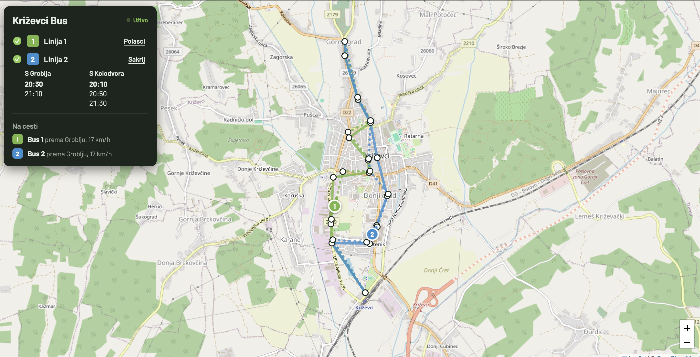
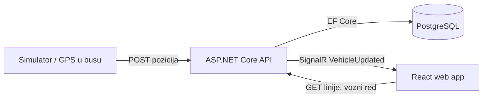

# Križevci Bus

Praćenje gradskih autobusa u Križevcima u stvarnom vremenu: gdje je bus sada, koje su sljedeće stanice i kada polazi.


> Projekt je u razvoju. Trenutno pozicije busova dolaze iz simulatora; u testnoj fazi planira se spajanje na stvarne GPS podatke.

## Funkcionalnosti

- Karta s linijama, stajalištima i trasom po smjeru vožnje
- Pozicije busova uživo (SignalR, bez osvježavanja stranice)
- Vozni red za radni dan i vikend
- Web aplikacija koja se može "instalirati" na mobitel (PWA)

## Stack

| Dio | Tehnologija |
|---|---|
| Backend | ASP.NET Core (.NET 10), Web API, SignalR |
| Baza | PostgreSQL 17, Entity Framework Core |
| Frontend | React, TypeScript, Vite, Leaflet + OpenStreetMap |
| Simulator | C# konzolna aplikacija |
| Infrastruktura | Docker Compose |

## Arhitektura



## Struktura repozitorija

```
krizevci-bus/
├── backend/            ASP.NET Core API
│   ├── Controllers/    REST endpointi
│   ├── Data/           DbContext, seeder, seed.json
│   ├── Dtos/           objekti koje API vraća
│   ├── Hubs/           SignalR hub
│   └── Models/         entiteti baze
├── web/                React aplikacija (u izradi)
├── simulator/          simulator vožnje (u izradi)
└── docker-compose.yml  PostgreSQL
```

## Model podataka

- **Line**: linija (naziv, boja)
- **Stop**: fizičko stajalište na jednoj strani ceste (svaki smjer ima svoje)
- **LineStop**: redoslijed stajališta na liniji po smjeru
- **RoutePoint**: točke trase po smjeru, za crtanje na karti
- **Departure**: polasci po smjeru i tipu dana (radni dan / vikend)
- **Vehicle** i **VehiclePosition**: bus i njegova zadnja poznata pozicija

Čuva se samo zadnja pozicija vozila, bez povijesti kretanja.

## Pokretanje lokalno

Potrebno: [.NET 10 SDK](https://dotnet.microsoft.com/download), [Docker](https://www.docker.com/), `dotnet-ef` alat.

```bash
dotnet tool install --global dotnet-ef --version 10.0.4
```

**1. Baza**

U rootu napravi `.env`:

```
DB_USER=busadmin
DB_PASSWORD=tvoja_lozinka
```

```bash
docker compose up -d
```

**2. Backend**

```bash
cd backend
dotnet user-secrets set "ConnectionStrings:Default" \
  "Host=localhost;Port=5432;Database=krizevcibus;Username=busadmin;Password=tvoja_lozinka"
dotnet ef database update
dotnet run
```

API radi na `http://localhost:5050`. Kod prvog pokretanja baza se napuni podacima iz `backend/Data/seed.json`.

## API

| Metoda | Endpoint | Opis |
|---|---|---|
| GET | `/api/lines` | Linije sa stajalištima i trasom po smjeru |
| GET | `/api/lines/{id}` | Jedna linija |
| GET | `/api/lines/{id}/departures?day=Weekday\|Weekend` | Vozni red (bez `day` vraća današnji) |
| GET | `/api/vehicles` | Vozila sa zadnjom pozicijom |
| POST | `/api/vehicles/{id}/position` | Nova pozicija vozila |

**SignalR:** `/hubs/vehicles`, događaj `VehicleUpdated` šalje se nakon svake nove pozicije.

Primjer:

```bash
curl -X POST http://localhost:5050/api/vehicles/1/position \
  -H "Content-Type: application/json" \
  -d '{"lat":46.02,"lng":16.54,"speed":30,"heading":90,"direction":"ToKolodvor"}'
```

## Plan razvoja

- [x] Baza, modeli i vozni red
- [x] REST API
- [x] SignalR za pozicije uživo
- [x] Koordinate stajališta
- [x] Simulator vožnje
- [x] React web s kartom
- [ ] PWA
- [ ] Procjena dolaska busa na stanicu
- [ ] Zaštita endpointa za pozicije (API ključ)
- [ ] Trasa po stvarnim ulicama
- [ ] Testno razdoblje sa stvarnim podacima
- [ ] iOS i Android aplikacije

## Podaci

Linije, stajališta i vozni red preuzeti su s javno objavljenog voznog reda gradskog prijevoza Križevci. Ovo je neovisni projekt i nije službena aplikacija Grada Križevaca ni prijevoznika.

## Autor

Matija Dudek
